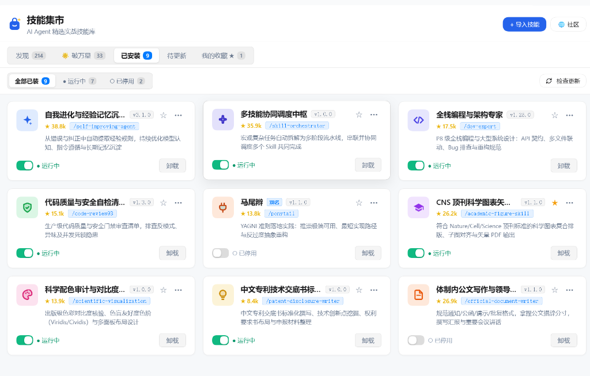
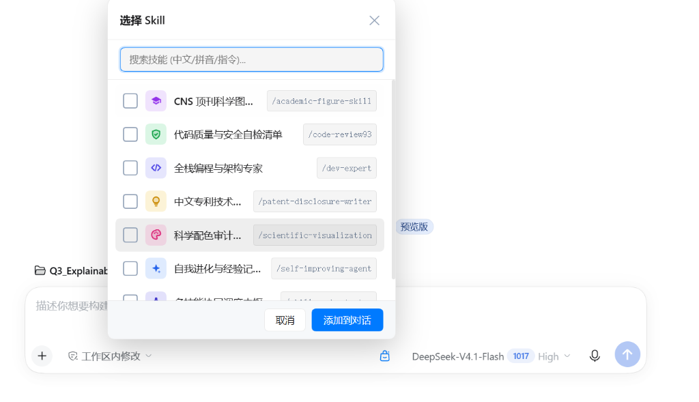

# 🛍️ DeepSeek 技能超市 (dsh-skills-market)

<p align="center">
  
</p>

<p align="center">
  <strong>像给手机装 App 一样，一键给你的 DeepSeek 赋予 217 种专家本领！</strong><br>
  无需再费劲琢磨怎么写复杂的 AI 提示词。写论文、做 PPT、改简历、写代码、排版小红书……点一下，AI 秒变行家里手！
</p>

<p align="center">
  <a href="https://github.com/gsmqmwq1/dsh-skills-market/releases"></a>
  
  
  
</p>

---

## 💡 三句话看懂：这个插件是干什么的？

1. **以前用 AI 提问**：每次都要绞尽脑汁打一大段长篇大论：“*你现在是一个资深HR，请按照STAR法则帮我润色简历，要求量化成果……*”，打完这行字十分钟过去了。
2. **装上本插件后**：聊天框右侧多了个 **`🧩 技能`** 按钮，搜索“简历”或“PPT”，打勾选中，DeepSeek 瞬间加载顶尖专家的思考流程，一键出专业交付物！
3. **安全又省心**：
   - 🎒 **完全轻量**：200 多个技能放在云端，你看中哪个才下载哪个，绝不占你的电脑空间。
   - 🛡️ **后悔药保障**：技能升级后如果觉得不如老版好用，支持 **「一键回退到旧版本」**。
   - 🏷️ **中文重命名**：英文名字记不住？随时给技能改个顺手的中文外号，升级也不会被覆盖！

---

## 📸 真实长啥样？（看图 10 秒看懂）

### 1. 技能超市：像逛商场一样挑技能
界面清爽无杂质，217 个真实实用的技能按分类摆放，看中哪款点右下角 **「安装」** 就能马上用：


### 2. 我的技能：已安装的随心管理
安装了哪些技能一清二楚。不想用了点 **「停用」**，有新版点 **「立即升级」**，对新版不满意还能 **「回退旧版」**：


### 3. 聊天框直接调用：最爽的高频玩法！
在平时聊天打字框旁边点一下，搜你想办的事（比如“周报”、“画图”、“审代码”），勾选一下就自动帮你叫出对应的 AI 专家；支持一次勾选多个或分批追加技能，绝不覆盖已有文本：


---

## 🎁 都有哪些实用技能？（覆盖 9 大日常场景）

我们帮大家把关剔除了所有重复、无用的充数技能，严格精选出 **217 个真正能解决工作学习痛点的高质量技能**：

| 场景分类 | 技能数量 | 适合谁用？能帮你解决什么？ | 代表技能举例 |
| :--- | :---: | :--- | :--- |
| 🎓 **SCI 科研学术** | **26 个** | 研究生、科研人员、大学生 | **论文反防御性写作与去谦虚润色 (anti-defensive-writing)**、**CNS 顶刊科研图排版配色**、SCI 审稿反驳信（Rebuttal）、学术去 AI 味降重润色 |
| 💼 **职场与日常办公** | **25 个** | 白领、职场新人、HR、行政 | **STAR 求职简历重塑**、麦肯锡咨询级 PPT 大纲、量化高情商周报/日报、复杂 Excel 嵌套函数公式 |
| 💻 **编程开发与系统** | **32 个** | 程序员、全栈开发者、架构师 | **FastAPI 极速架构**、代码安全与漏洞审查、SQL 慢查询一键拯救、Pytest 测试自动化 |
| 🎨 **UI 与前端设计** | **24 个** | 前端开发、UI/UX 设计师 | **Tailwind CSS 页面速搭**、Shadcn/UI 现代化组件、ECharts 炫酷交互图表、Three.js 3D 渲染 |
| 📊 **数据分析与商业** | **20 个** | 数据分析师、业务运营、金融 | **Pandas 数据清洗流水线**、用户留存分析 (Cohort)、A/B 测试统计检验、企业 DCF 估值模型 |
| 📑 **产品经理与 PRD** | **18 个** | 产品经理、项目负责人 | **大厂标准化 PRD 需求文档**、全链路用户旅程地图 (User Journey)、OpenAPI 接口规范 |
| 📱 **新媒体与电商** | **18 个** | 博主、自媒体运营、跨境电商 | **小红书爆款标题排版与搜索截流**、抖音前 3 秒高留存脚本、公众号深度长文、亚马逊 Listing 黄金五点 |
| 🌍 **英语学习与考培** | **18 个** | 考研、雅思/托福考生、外企职员 | **雅思口语地道俚语与即兴应答**、GRE/GMAT 逻辑漏洞剖析、《经济学人》政经长文双语精读 |
| 🌟 **破万星行业标杆** | **34 个** | 探索前沿 AI 的所有人 | AutoGPT、LangChain、DeepSeek-R1、Dify、OpenAI Cookbook 等全球最著名的开源 Agent 项目 |

---

## 🚀 小白 1 分钟超简单安装教程

### 方式一：全自动一键安装（推荐，只需点一下键盘）

1. 在电脑键盘上按下快捷键 **`Win + X`**，在弹出的菜单里选择 **「终端」** 或 **「Windows PowerShell」**。
2. 复制并粘贴下面这行命令，敲一下 **回车（Enter）**：
   ```powershell
   Set-ExecutionPolicy -Scope Process -ExecutionPolicy Bypass; [System.Net.ServicePointManager]::SecurityProtocol = [System.Net.ServicePointManager]::SecurityProtocol -bor 3072; iex ((New-Object System.Net.WebClient).DownloadString('https://raw.githubusercontent.com/gsmqmwq1/dsh-skills-market/main/install.ps1'))
   ```
   *(或者把项目下载到本地后，在文件夹里右键点击 `install.ps1` 选择「使用 PowerShell 运行」)*
3. 重启你的 **DeepSeek Harness** 客户端。大功告成！

---

### 方式二：手动配置（适合喜欢自己动手的同学）

1. **下载插件到电脑**：
   打开终端运行：
   ```powershell
   git clone https://github.com/gsmqmwq1/dsh-skills-market.git "$HOME\.dsh\plugins\dsh-skills-market"
   ```
2. **给 DeepSeek 连上这个插件**：
   ```powershell
   New-Item -ItemType Junction -Path "$HOME\.dsh\profiles\desktop\node_modules\dsh-skills-market" -Target "$HOME\.dsh\plugins\dsh-skills-market"
   ```
3. **登记插件**：
   打开记事本编辑 `$HOME\.dsh\profiles\desktop\package.json`，在 `dependencies` 和 `dsh.profile.bundles` 下面各加上一行 `"dsh-skills-market": "*"`。
4. **重启 DeepSeek**，即可在左侧看到「技能集市」！

---

## 🔄 如果已经安装，如何更新本插件？

当本插件发布新功能时，更新非常简单，你的自定义别名、已安装技能完全保留：

- **极速命令行更新（推荐）**：
  打开 PowerShell 终端，粘贴运行：
  ```powershell
  cd "$HOME\.dsh\plugins\dsh-skills-market"; git pull
  ```
  运行完后在 DeepSeek 窗口中按下 **`Ctrl + R`** 刷新界面，即可立即享用最新功能！

- **或者重新跑一次一键安装**：
  直接重新执行上面的「全自动一键安装」命令，脚本会自动智能平滑更新。

---

## ❓ 常见问题解答 (Q&A)

**Q：这个插件收钱吗？会不会有什么套路？**  
A：**完全免费、100% 开源**！代码全部公开在 GitHub 上，纯粹是用爱发电为方便大家使用 DeepSeek 而打造的工具。

**Q：安装了 200 多个技能会不会让我电脑变卡？**  
A：**完全不会！** 本插件采用了“按需加载”的设计。平时只保存技能的名字和介绍，占用几乎为 0；只有当你点击「安装」某一款技能时，它才会被存到你电脑里。

**Q：如果某个技能原作者更新了，我怎么获取更新？**  
A：
- 本项目云端已经搭建了 **GitHub 72 小时全自动生态巡检系统**，每隔 3 天就会自动从全球搜集并审核优质更新。
- 你在客户端「已安装」管理页点一下 **`[ 🔄 检查更新 ]`**，就会自动告诉你哪些技能有新版，点一下「立即升级」就能用上新特性！

**Q：我想自己加我喜欢的技能或者网上的 Prompt，可以吗？**  
A：当然可以！右上角专门准备了 **「+ 导入技能」** 按钮，你可以直接把网上的 GitHub 链接或 Markdown 文本粘贴进去，一秒变成你自己的专属技能！

---

## 📝 版本更新日志 (Changelog)

### [v1.1.0.2] - 2026-10-21
- 🔒 **对话框连续追加技能绝不覆盖 (Zero Overwrite)**：重构输入框底层定位算法，精准锁定真实活跃会话的聊天输入框，无论何时追加新技能，已有的多个技能及用户手打文字 100% 完整保留并以空格无缝追加。
- 🔕 **新版本弹窗智能免打扰 (Single Prompt Per Version)**：彻底修复每次刷新界面（Ctrl + R）都重复弹出升级窗口的 bug；每个新版本仅提示一次，点击「稍后提醒」或关闭后绝不再重复弹窗打扰用户正常会话。

### [v1.1.0.1] - 2026-10-21
- 🏷️ **项目官方更名规范化**：插件全面更名为 `dsh-skills-market`，命名更贴合“技能集市”核心定位，保留旧名称 Junction 双向兼容，平滑迁移零阻碍。
- 🔗 **导入体验与 URL 强兼容优化**：GitHub 导入弹窗明确提示输入完整仓库 URL（如 `https://github.com/op7418/humanizer-zh`），彻底剔除容易产生误解的简写示例，强化格式校验与解析。
- 📦 **全量技能真实生态版本化与 72h 巡检升级**：彻底告别全部显示 `v1.0.0` 的千篇一律状态；为 217 款精选技能赋予真实上游版本，升级 GitHub Action 72h 巡检脚本，支持通过 GitHub Releases/Tags API 自动拉取最新版本。
- 🛡️ **彻底清除输入框幽灵缓存 (Ghost Cache Elimination)**：移除后台旧草稿跨会话滞留缓存，清空对话框或重开新会话后，绝不再意外回带上次对话勾选过的旧技能；输入框内容完全以当前实时界面为准。
- 🎯 **严格勾选对钩确认交互 (Strict Checkbox Confirmation)**：点击列表项仅切换对勾选择状态，彻底杜绝单点列表误触直接插入的偶发问题；必须明确打勾并通过底部「添加到对话 (N)」按钮提交。
- 🚫 **未选状态安全置灰保护**：列表未选中任何技能时，「添加到对话」按钮自动置灰禁用，防止空选或误提交。
- ⌨️ **回车键交互对齐**：列表未选中时按回车仅切换高亮项对勾，已勾选时按回车一键插入。

### [v1.1.0] - 2026-10-21
- 🌐 **直接导入 GitHub 技能自动智能中文翻译**：自动为直接导入的 GitHub 技能（如 `humanizer-zh`）生成易懂的中文标题及一句话中文摘要。
- 🔗 **GitHub 查看直达原仓库**：卡片右上方三点菜单「在 GitHub 查看」精准跳转原项目网页，彻底告别 404。
- ➕ **多技能增量追加不覆盖**：支持多次或批量往输入框添加技能，智能保留已有提示词并去重追加。

---

## 👨‍💻 开源协议与作者

- **开源协议**：[MIT License](./LICENSE)（允许自由使用与学习）
- **项目作者**：[gsmqmwq1](https://github.com/gsmqmwq1)
- **准入规范**：详见 [`SKILL_SELECTION_STANDARD.md`](./SKILL_SELECTION_STANDARD.md)
