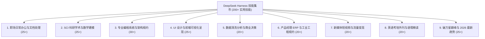

# DeepSeek Harness Agent 技能集市准入与评估标准规约
> **版本**：v1.0.0 · 2026 标准规范  
> **制定主体**：DeepSeek Harness 技能集市产品与工程团队  
> **核心定位**：专为客制化任务规范化、标准化打造的纯正 AI Agent 技能体系

---

## 一、 核心定义：什么是真正的 Agent 技能（Skill）？

### 1. 核心本质：客制化任务的“规范化”与“标准化”
一个合格的 Agent Skill，**不是底层的软件依赖库（如 npm 包或 pip 包），也不是一段没有约束的空洞代码**，而是：
> **一个针对特定专业垂直任务（如简历包装、PPT结构设计、周报量化、SCI论文反驳、顶刊科学绘图、工业PID图符设计等）打造的高水平专家级指令与工作流规约包（Prompt Rule Package）。**

当用户在 DeepSeek Harness 中输入 `/skill-name` 时，模型应即刻切换至该专业领域的顶级专家心智，严格执行标准化的 SOP 流水线，并遵循刚性输出规范，直接向用户交付**生产级、开箱即用的高水准成果**。

### 2. 标杆对照：真正 Skill vs 常见伪 Skill

| 维度 | ❌ 严禁入选的伪 Skill（常见误区） | ✅ 必须收录的真 Skill（标准形态） |
| :--- | :--- | :--- |
| **底层属性** | `tiangolo/fastapi` 软件库代码、pip 依赖 | 教 AI 怎么写出异步流式防断联、带 Pydantic v2 校验的 FastAPI 专家规约 |
| **任务目标** | 笼统模糊地聊天：“请帮我写个文档” | 明确解决痛点：“高情商量化周报”、“麦肯锡金字塔原理PPT大纲”、“简历STAR法则重塑” |
| **执行逻辑** | 无约束自由发散，输出大量空洞废话 | 拥有阶梯式执行步骤（SOP）、格式约束模板与负向防越界边界 |
| **独立性** | 相同仓库套用数字编号凑数（方案1~50） | 每个技能独立对应一个具体高频业务场景，拥有专属触发意图与中文关键词 |
| **交付价值** | 用户需要自己从零教模型怎么做 | 模型一键调用后，直接输出标准化、结构化的高质量定制交付物 |

---

## 二、 技能入库 5 大黄金准入原则

为确保集市中每一项技能都“**真好用、真解决问题、零充数**”，所有新录入技能必须通过以下 5 维核验：

### 准则 1：解决具体明确的客制化业务痛点 (Task-Oriented)
- 技能必须有明确的**输入场景**与**预期产出**。
- 例如：
  - 输入杂乱工作记录 → 输出符合管理层预期的**量化高情商周报**。
  - 输入项目零散信息 → 输出符合投资人/评审人审阅的**麦肯锡金字塔 PPT 幻灯片大纲**。
  - 输入粗糙个人经历 → 输出符合大厂 HR 筛选标准的**STAR 法则量化简历**。
  - 输入乱序实验数据 → 输出符合 Nature/Cell/Science 顶刊规范的**矢量复合制图代码**。

### 准则 2：结构完备的标准工程结构 (Standard Architecture)
每个技能的标准载体必须是符合规范的 `SKILL.md`，至少包含以下 4 个部分：
1. **Frontmatter 元数据**：唯一 ID、中文友好名称、清晰的适用场景描述与触发词。
2. **专家心智定位 (Persona)**：明确模型的角色定位与专业视角。
3. **分步执行规约 (Execution SOP)**：明确思考顺序与决策树，先做什么、后做什么。
4. **刚性交付物模板 (Output Spec)**：指定最终 Markdown、表格或代码的呈现形式，杜绝无意义套话。

### 准则 3：真实的社区热度与影响力 (Authentic Stars)
- 优先收录 GitHub Star 真实且 $\ge 1000$（★ 1k+）的开源热门 Agent 规约。
- 对于解决极其垂直痛点（如特定工业标准、小众高阶科研制图）的实用精品技能，放宽至真实 Star $\ge 500$（★ 500+）。
- 绝不编造虚假数据，每个技能附带真实 GitHub 溯源链接。

### 准则 4：拒绝套壳裂变与重复 (Anti-Duplication)
- 严格遵循“一个仓库/专长对应一个技能”原则。
- 严禁将单一模板库通过修改标题编号裂变成几十个技能。

### 准则 5：紧跟 2026 前沿生态与实用工具 (Latest & 2026-Ready)
- 紧跟 2026 年最新 Agent 演进范式，收录 DeepSeek-R1 长思维链推理规约、Anthropic FastMCP 工具协议、Browser-Use 视觉自主操作、Mem0 长期个性化记忆等最新实践。

### 准则 6：上下文轻量化与 Token 预算刚性控制 (Context-Friendly & Token Budget)
- **DeepSeek 上下文护城河原则**：针对 DeepSeek 等模型有限的上下文窗口，单个技能规约包必须追求“**极致高信噪比、精炼极简、刀刀见肉**”。
- **单技能 Token 预算**：每个 `SKILL.md` 文本体积刚性限制在 **1KB ~ 3.5KB**（约 **350 ~ 800 Tokens**），严禁超过 1200 Tokens。
- **杜绝巨型代码与万字文档**：
  - 严禁将底层开源库的源代码、全量 API 字典或万字理论说明书一股脑打包成 Prompt；
  - 仅提炼最核心的**专家心智 (Persona)、分步阶梯执行 SOP (Ladder Steps)、交付物结构模板 (Output Spec) 与负向防越界边界**；
  - 确保即使在对话中同时加载 3~4 个不同技能，总 Token 消耗仍控制在 2500 Tokens 以内，将 **90%~95% 以上的宝贵上下文空间**完整保留给用户的实际输入文档、代码文件与长思维链推理。

---

## 三、 核心九大业务板块与任务覆盖矩阵 (目标 200+ 精品规模)

### 1. 🏢 职场日常办公与综合文档处理 (25+ 个)
- **简历包装**：STAR 法则量化成果润色、大厂技术岗/管理岗简历排版、英文求职简历对齐
- **PPT 制作**：麦肯锡金字塔原理商业汇报 PPT 大纲、技术选型方案宣讲 PPT、述职答辩框架
- **日报/周报**：高情商量化周报、向上汇报困难阻碍要点、部门月度复盘看板
- **Excel 表格**：跨表多维数据清洗、高阶动态数组公式（XLOOKUP/LAMBDA）、VBA 批量宏
- **日常公文**：体制内红头公文/通知/请示规范、领导重要会议发言致辞、商务催办与协调邮件
- **会议与流程**：录音速记提炼 Action Items 责任清单、Mermaid 业务流程图与脑图

### 2. 🔬 SCI 科研学术与数学建模 (25+ 个)
- **学术绘图**：CNS 顶刊复合图排版、Seaborn 科学配色 Viridis 审计、爱思唯尔 85mm/175mm 规约
- **论文写作**：SCI 黄金四段式 Abstract、学术去 AI 机械味精修、IEEE 期刊引言论证
- **同行评审**：审稿意见逐条反驳信（Rebuttal/Response Letter）、审稿专家挑刺自查
- **文献调研**：文献多维横向对比三线表、PRISMA 系统性综述流程、学术 Gap 创新点挖掘
- **算法代码**：顶会论文开源代码复现助手、论文伪代码逆向解构、LaTeX 双栏公式排错
- **数模竞赛**：国赛/美赛微分方程物理机理建模、运筹规划求解全套模板

### 3. 💻 专业编程系统与架构规约 (30+ 个)
- **架构哲学**：极简主义反过度设计 (Ponytail)、DDD 领域驱动设计分层解耦、微服务拆分
- **质量门禁**：生产级代码审查门禁 (Code Review)、OWASP Top 10 安全漏洞审计
- **全栈开发**：FastAPI+DeepSeek 异步流式后端、Django 企业系统架构、RESTful API 契约
- **工程运维**：Git Conventional Commits 自动提炼、Pytest 自动化单测与 Mock、Docker 容器化瘦身
- **数据存储**：SQL 慢查询 EXPLAIN 执行计划调优、SQLAlchemy 2.0 ORM 建模、Redis 分布式锁

### 4. 🎨 UI设计与前端可视化呈现 (25+ 个)
- **组件系统**：Shadcn/UI 现代化深浅色无障碍组件、Ant Design 企业级 B 端交互规范
- **网页美化**：Tailwind CSS 弥散光与毛玻璃、Framer Motion 阻尼交互动效、SaaS 官网首屏
- **图表交互**：Apache ECharts 多图联动看板、Three.js 3D 轻量数据大屏、D3.js 定制可视化
- **图形工具**：Excalidraw 手绘白板架构图、纯文本 Mermaid 时序拓扑图、24x24 极简 SVG 图标

### 5. 📊 数据清洗分析与商业决策 (20+ 个)
- **数据清洗**：杂乱脏数据缺失值自动智能补全、多元离群异常值检测
- **探索分析**：Pandas 自动化探索性数据分析 (EDA) 报告、列相关性矩阵热图
- **商业看板**：Plotly/Dash 纯 Python 商业 BI 动态看板、Power BI 核心 DAX 度量值设计
- **统计预测**：多元线性回归与假设检验三线表、Prophet 商业长程指标时序预测
- **模型解释**：机器学习黑盒模型 SHAP 边际贡献分析与归因图

### 6. 📑 产品经理 ERP 与工业工程规约 (20+ 个)
- **需求设计**：标准互联网 PRD 需求文档全分支设计、用户故事与验收标准 (AC)
- **企业蓝图**：ERP 进销存供应链业务蓝图、BOM 展开与多级仓储流转
- **工业规约**：化工与管道仪表流程图符规约 (ISA-5.1 标准)、车间 MES 系统数据流规约
- **商业模式**：B2B SaaS 阶梯用量计费模型测算、市场需求 MRD 竞品 SWOT 矩阵
- **体验设计**：全链路用户体验旅程地图与触点漏斗、全站数据埋点事件字典

### 7. 📱 新媒体短视频与流量运营 (20+ 个)
- **爆款文案**：小红书万赞种草笔记文案公式、微信公众号深度特稿金字塔结构
- **视频脚本**：抖音完播率前 3 秒黄金 Hook、中长视频信息缺口与悬念叙事、B站硬核科普解说
- **直播电商**：直播带货痛点唤醒与逼单促成话术、情绪节奏卡点
- **流量矩阵**：全网搜索长尾词聚类与矩阵布局、自媒体多渠道转化漏斗复盘看板

### 8. 🌍 英语考培外刊与语境精读 (20+ 个)
- **权威雅思**：雅思大作文 Task 2 九分 TR/CC/LR/GRA 严密对标、口语 Part 1-3 思维拓展
- **权威托福**：托福综合写作听读反驳论点提炼、学术口语速记与转述模板
- **国内考研/四六级**：考研英语真题干扰项排除、四六级长难句语法主干逆向剖析、传统文化汉译英
- **外刊精读**：经济学人商业特稿双语精读、纽约时报社论高级修辞与批判性思维
- **语境习得**：看英美剧语境学地道口语短语与 B2-C1 词汇迁移

### 9. 🌟 破万星巅峰与 2026 最新趋势 (25+ 个)
- **前沿推理**：DeepSeek-R1 长思维链深度反思与数学推导、DSPy 算法化提示词编程
- **协议与工具**：FastMCP 标准上下文工具扩展协议、Browser-Use 视觉自主网页操作
- **记忆与知识**：Mem0 跨会话长期自适应记忆系统、微软 GraphRAG 知识图谱复杂推理
- **经典巅峰**：AutoGPT 自主目标驱动智能体、LangChain 现代链式编排、OpenAI Cookbook 生产配方

---

## 四、 后续技能扩充与审核标准操作规程 (SOP)

为保证未来的扩展持续符合本规约，新增任何 Skill 时必须执行以下三步法：
1. **第一步（需求审查）**：审查该技能是否解决具体的定制任务（例如“帮写周报”、“帮做PPT大纲”），是否交付可直接采用的成果。
2. **第二步（真实溯源）**：核验其开源 GitHub 来源或 ClawHub 官方源，确保真实 Star $\ge 500$（优先 $\ge 1000$），严禁虚构。
3. **第三步（规约封装）**：编写规范的 `SKILL.md`，注入标准 Frontmatter、角色心智、SOP 阶梯与输出约束，并进行本地调用验证。
